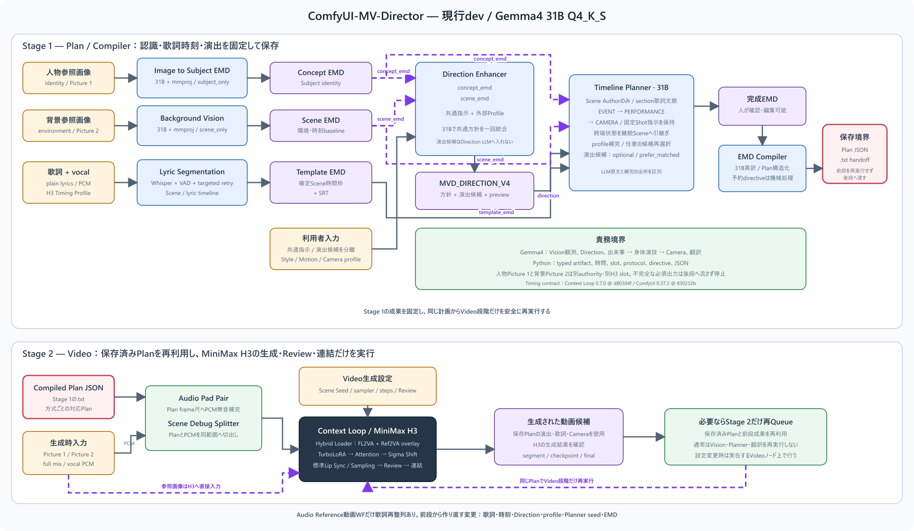

# ComfyUI-MV-Director

人物・背景の参照画像、歌詞、ボーカルステム、フルミックスから、MiniMax H3 / Context Loop用のMV計画を作るComfyUIカスタムノードです。現行の開発workflowはGemma4 31Bで画像認識、演出方針、Sceneごとの出来事・人物演技・カメラ、英訳を処理し、編集可能なEMDと再利用可能なPlan JSONを保存します。動画生成にはFL2VAをベースにRef2VAの参照レイヤーを重ねるHybrid Loaderを使用します。

ボーカルステムは、歌詞の時間整列とリップシンクに使用します。歌詞だけでは実際の発声時刻が分からないため、VAD（Voice Activity Detection：音声活動検出）とWhisperで発声区間・歌詞のタイミングを解析し、テンプレートタイムラインを生成します。H3 / Context Loopにもボーカルを渡し、歌声に合わせた口の動きを生成します。伴奏を含むフルミックスでは音声の判別が難しくなるため、このworkflowでは分離したボーカルを使用します。

ボーカルステムは、利用中の音楽生成サービスのステム書き出し機能、または音源分離ツールで用意してください。フルミックスは別途、完成動画の楽曲として使用します。

EMDは **Easy MarkDown** の略です。Extended Markdownではありません。

## はじめに

1. [導入マニュアル](docs/installation.md)に従ってカスタムノード、`llama-cpp-python`、Whisper、各モデルを準備します。
2. [配布workflow](workflows/README.md)の`01_plan_compiler.json`と`02_video_generator.json`を一組で使います。配布するのはContext Loop標準リップシンク方式の2本で、どちらも最大4Subjectに対応します。Audio参照方式と歌詞方式は保留中で、現在は同梱していません。
3. [ノードマニュアル](docs/nodes/README.md)で各入力、出力、既定値、接続方法を確認します。
4. EMDを直接編集する場合は[EMD仕様書](docs/spec/emd-spec.md)を参照します。

現行の開発構成は`dev`ブランチです。既存のリリースタグとはモデル・パイプラインが異なります。2026-10-15にローカルで確認した導入環境は次のとおりです。

| コンポーネント | バージョン | コミット |
|---|---|---|
| ComfyUI | v0.39.2 | `3c1b7a17fdf239d35ce98cc777756f572d089795` |
| MiniMax H3 Context Loop | 0.7.3 | `3c2af7308b9f709f9e10795332181f41597757ee` |
| Spectrum MiniMax H3 | v0.2.27 | `120d72e2f48b781235b34149e39bbdf0f1317d82` |

これは導入済みコードの確認値であり、全設定での安定動作を保証するものではありません。高速化設定、過去の全編完走実績と検証条件は[TIPS](docs/tips/h3-acceleration-and-stability.md)を参照してください。

Gemma4 31B構成はRTX 5090・RTX 5080環境で検証しています。VRAM 8 GB環境は現在の対象外です。必要なVRAM・メインメモリは量子化、context、オフロード設定で変わるため、未検証環境の最低容量は断定していません。

`# 共通プロンプト`は全体方針、`# 演出候補`は歌詞に応じた局所演出として記述できます。候補は全Sceneへ一律に適用されません。人物の再現性、演技、リップシンクなどの最終的な採否は、生成映像を見て判断してください。

LLMの出力は確率的で、行protocol違反や必須出力の欠落が起きる場合があります。構造検証と有限回の再試行を行いますが、必ず成功することは保証しません。再試行時のseed・cacheの扱いは[トラブルシューティング](docs/troubleshooting.md#llmの行protocol不整合が発生する)を参照してください。

## 簡単な利用方法

演出を考える際は、[歌詞・シーン・キャラクターから演出候補を作るTIPS](docs/tips/staging-candidate-authoring-prompt.md)を利用できます。再利用用プロンプトと歌詞全文・舞台・人物設定をChatGPT／Codexへ渡し、生成した`# 共通プロンプト`・`# 演出候補`を01_ WFのDirection Enhancerの`user_request`へ設定します。歌詞の意味を具体的な演技やCameraへ展開するための補助であり、候補の採用や映像での再現を保証するものではありません。

**参照画像だけでなく、人物のヒントも作品に合わせて変更してください。** 配布WFには、狐耳・尻尾などを指定した検証用の`subject_hint`が入っています。画像だけを差し替えてヒントを残すと、画像にないケモミミや尻尾、以前の衣装などが生成される場合があります。[Image to Subject EMD](docs/nodes/image-to-subject-emd.md)の`subject_hint`を自分の人物の識別特徴・衣装・小道具等へ書き換えるか、不要なら空欄にしてください。`additional_instruction`も観察方針に合わせて確認します。`hint_mode=lock_identity`ではヒントが外見推定より優先されます。使用する各Subjectで確認し、演出候補の検証用題材も置き換えてください。

1. [01_plan_compiler.json](workflows/01_plan_compiler.json)をComfyUIで開き、人物・背景の参照画像、歌詞テキスト、ボーカルステムと演出方針を設定して実行します。EMD・Plan JSON・SRT・LRC本文がComfyUIの`output/mv_director/4subject`以下へ保存されます。Plan JSONの保存形式は`.txt`です。SRT・LRC本文も`.txt`で保存されるため、字幕・歌詞ファイルとして使う場合は拡張子を`.srt`・`.lrc`へ変更します。
2. [02_video_generator.json](workflows/02_video_generator.json)を開き、Plan JSONの`.txt`を「Compiled Plan JSON (.txt handoff)」へ読み込みます。01と同じ参照画像・ボーカルステムと、完成動画用のフルミックスを指定して実行します。Plan Studioも組み込まれており、生成済みSceneのALT作成と採用後の全編再連結については[配布workflowの説明](workflows/README.md#plan-studioで一つのsceneを差し替える)を参照してください。

現在の2本は最大4Subject対応です。**使用しないSubjectの参照画像ローダーと、それに接続されたImage to Subject EMDの両ノードをバイパス**してください。例えば二人だけを使う場合は、Subject 3・4の各画像ローダーと各Image to Subject EMDをバイパスします。画像欄を空にするだけではなく、未使用の組をまとめてバイパスしてください。背景用のノードはSubjectとは別なので、背景を使う場合は有効のままにします。

同じPlanで動画を再生成する場合は、02だけを再実行できます。歌詞、人物のヒント、演出方針を変更した場合は、01でPlanを作り直し、生成されたEMDのSubject定義を確認してから02へ読み込み直してください。既存Planの人物設定は、元ノードのヒントを変更するだけでは更新されません。

## 文書索引

| 場所 | 内容 |
|---|---|
| [`docs/`](docs/README.md) | 利用者向け・開発者向け文書の総合索引 |
| [`docs/nodes/`](docs/nodes/README.md) | 公開12ノードの操作マニュアル |
| [`docs/spec/`](docs/spec/README.md) | EMD、protocol、最小コアの規範仕様 |
| [`docs/implementation/`](docs/implementation/README.md) | 内部構造、公開surface、実装順序 |
| [`profiles/`](profiles/README.md) | ユーザー拡張可能なStyle、Motion、Camera profile EMD |
| [`workflows/`](workflows/README.md) | Context Loop標準リップシンクのPlan生成・動画生成の2本（最大4Subject対応） |
| [`docs/assets/`](docs/assets/README.md) | READMEや文書で使うPNG/SVG図版 |
| [`docs/tips/`](docs/tips/README.md) | 参照画像の分離、再現率、配線など実運用のTIPS |
| [Direction / Planner処理フロー](docs/architecture/direction-planner-flow.md) | LLM task、Python所有処理、AS IS境界の図解 |
| 研究記録（リポジトリ外） | 実験ログ・調査レポートはローカルの`ComfyUI-MV-Director-research`へ保存。配布リポジトリには含めない |

## 公開ノード

| 区分 | ノード | マニュアル |
|---|---|---|
| Core | Image to Subject EMD | [画像からSubject EMDを作る](docs/nodes/image-to-subject-emd.md) |
| Core | Direction Enhancer | [全体演出を作る](docs/nodes/direction-enhancer.md) |
| Core | Timeline Planner | [歌詞と時間枠へShotを計画する](docs/nodes/timeline-planner.md) |
| Core | EMD Compiler (Ref2VA) | [EMDをPlan JSONへ変換する](docs/nodes/emd-compiler.md) |
| Input | Lyric Segmentation | [歌詞、SRT、timelineを整列する](docs/nodes/lyric-segmentation.md) |
| Audio | Audio Pad Pair | [full mixとvocalをPCM無音で整える](docs/nodes/audio-pad-pair.md) |
| Utilities | H3 Timing Profile | [H3時間契約を共有する](docs/nodes/h3-timing-profile.md) |
| Utilities | 32-bit Seed | [再現可能なseedを分岐する](docs/nodes/seed32.md) |
| Utilities | String Combo | [有限文字列リストを選ぶ](docs/nodes/string-combo.md) |
| Utilities | Connected Combo | [サブグラフ内comboを外へ出す](docs/nodes/connected-combo.md) |
| Utilities | Load Text File | [UTF-8 lyricsファイルを読む](docs/nodes/load-text-file.md) |
| Utilities | Scene Debug Splitter | [PlanとPCMを連続Scene範囲へ切り出す](docs/nodes/scene-debug-splitter.md) |

ノードIDは`MVDirector...`、表示カテゴリは`MV Director/...`、内部socket型は`MV_DIRECTOR_...`です。旧プロトタイプとの互換aliasは登録しません。

## 更新履歴（主要な変更のみ）

主要な変更は[CHANGELOG.md](CHANGELOG.md)を参照してください。

## ライセンス

Copyright © 2026 `wsoldwolf`

ソースコードと文書は、別途明記された場合を除き[GNU General Public License v3.0 only](LICENSE)（`GPL-3.0-only`）です。

`assets/`の検証用楽曲、歌詞、ボーカルステム及び参照画像はソフトウェアライセンスの対象外です。対象素材と条件は[ASSET_LICENSES.md](ASSET_LICENSES.md)を参照してください。
